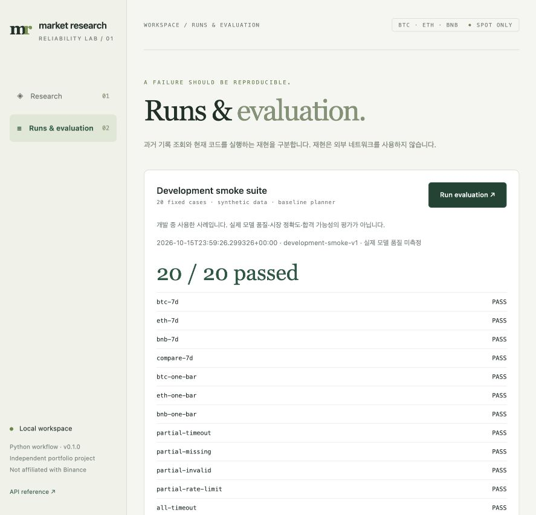

# Market Research Agent — Reliability Lab

A small full-stack research tool that makes market calculations inspectable and failures reproducible.

Compare BTCUSDT, ETHUSDT, and BNBUSDT over the same completed UTC daily bars. Inspect the original prices, citations, tool errors, and execution record. Run the current workflow again using recorded HTTP responses, including failures.

**Status: runnable local MVP.** CLI, FastAPI, a build-free JavaScript console, synthetic failure scenarios, atomic run storage, strict HTTP replay, and a 20-case development evaluator are implemented. The default runs offline without an LLM. Optional Ollama and GPT-6 Astra planners and live Binance data use the same workflow. GPT-6 Astra requires OPENAI_API_KEY; its real API comparison has not been run.

The architecture is a fixed research workflow with an optional LLM planner. The model does not autonomously choose tools or run an observe–act loop.

Independent portfolio project; not affiliated with Binance. No trading or prediction.

## Run locally

Python 3.10+ is declared; verification used Python 3.13.9. From this repository:

```sh
python3 -m venv .venv
.venv/bin/python -m pip install .
PYTHONPATH=src .venv/bin/python -m market_agent serve
```

Open [the local console](http://127.0.0.1:8000). Installation needs package access; default demo execution uses no external network. The server binds to loopback and has no multi-user authentication. It is not a public deployment.

The console provides research, source inspection, run history, replay, evaluation, and JSON export. Select **ETH timeout** to see a partial result, expand **Inspect execution**, and choose **Replay recorded responses**. Data source and planner are separate controls: synthetic data with an Ollama planner still makes a local model call.



## CLI

Use `PYTHONPATH=src` to run this checkout after edits. Ordinary installation copies the package; reinstall to update the installed copy. The installed `market-agent` entry point provides the same commands.

```sh
PYTHONPATH=src python3 -m market_agent research 'BTC ETH BNB 7d'
PYTHONPATH=src python3 -m market_agent research 'BTC ETH BNB 7d' --scenario eth_timeout
PYTHONPATH=src python3 -m market_agent replay RUN_ID_FROM_PREVIOUS_COMMAND
PYTHONPATH=src python3 -m market_agent evaluate --output .market-agent/evaluation.json
PYTHONPATH=src python3 -m unittest discover -s tests -v
```

Live data needs access to Binance's public market-data endpoint; no account or API key is used:

```sh
PYTHONPATH=src python3 -m market_agent research 'BTC ETH BNB 7d' --mode live
```

For the local planner, first run Ollama and install `qwen3:8b`, then:

```sh
PYTHONPATH=src python3 -m market_agent research 'BTC 7d' --planner ollama
```

Ollama is called at `http://127.0.0.1:11434`. Its JSON plan must agree with the bounded request contract. It does not generate prices or the numerical report. This is Python orchestration, not native model tool calling or an MCP server. The baseline parser is deliberately conservative; arbitrary natural-language requests are not supported.

Runs are saved under `.market-agent/runs/` (ignored by Git). A global `--data-dir PATH` option goes before the subcommand. `--as-of` accepts a timezone-aware ISO timestamp; demo data is fixed to 2026-10-16 UTC. Live mode defaults to the actual run start time.

## Evidence contract

- `24h` means **one completed UTC daily candle**, and `7d` means seven. Neither is a rolling window. Explicit rolling-window and arbitrary-date requests require clarification.
- Capture `as_of` once. End at its UTC midnight; use `[start, end)` for every symbol.
- Calculate `(last_close / first_open - 1) * 100` from original decimal strings at 40-digit precision. Store that value separately from two-decimal, half-up display rounding.
- Reject missing, duplicate, unordered, incomplete, malformed, and invalid-price candles. Keep each symbol's failure and return `partial` when other requested symbols succeed.
- The bundled corpus contains **three reviewed API-document paraphrases**, not news or a live web search. Document-only results are retrieval evidence and remain `insufficient_evidence`; price movement causes are not established.
- Market collection runs once per symbol. At most one additional document search is allowed. A collection round is not an HTTP-call count. There are no automatic HTTP retries. HTTP 418/429 stops remaining market requests in that run.

## Verification and limits

The current revision passes **64 unit/integration tests**. The initial baseline passed **20/20 synthetic development smoke cases**; after fixing the planner contract, a real Qwen run also passed **20/20**, with 15 actual model requests. This is a bounded application check, not general model accuracy. The smoke set was used during implementation and is not held out. Its rational numerical expectations are authored separately from the production calculator. A mutation check confirms that a wrong return is detected.

On 2026-10-16 KST, one live Binance research request and one real `qwen3:8b` planning request also completed. These are connection checks, not model-quality or live-market accuracy benchmarks. Full records and environment details are in [validation](docs/validation.md).

Replay runs the current workflow with frozen requests/responses and the original corpus snapshot. Method, URL, body, order, missing calls, and unused responses are checked; there is no network fallback. The result comparison excludes market retrieval timestamps and includes source contents. Model responses are frozen too. The CLI evaluation now runs a selected live model against the same synthetic market fixtures; strict replay still freezes model responses as well.

There is no public deployment, user-demand validation, held-out model evaluation, Astra-vs-Qwen result, or demonstrated agent-vs-baseline improvement. A real user-triggered planner validation failure and its correction are documented. Those are the next portfolio evidence, not claims this MVP makes.

## Code and authorship

- [runtime.py](src/market_agent/runtime.py): bounded request handling, optional model plan, partial failure, report rendering.
- [tools.py](src/market_agent/tools.py): Decimal calculations, strict candle checks, small-corpus BM25.
- [records.py](src/market_agent/records.py): atomic JSON storage and strict HTTP recording/replay.
- [evaluate.py](src/market_agent/evaluate.py): independent expectations and raw development results.
- [api.py](src/market_agent/api.py), [web](src/market_agent/web): shared backend and browser console.
- [llm.py](src/market_agent/llm.py), [schema.py](src/market_agent/schema.py): existing transport and validated research contracts.

The first implementation of the new runtime, tools, console, and tests was AI-assisted. Existing model-call code was preserved; schemas and schema tests originated from the owner's repository and were extended. Ownership, provenance, and the next learning tasks are recorded in [development notes](docs/development.md). Do not present generated code as independently authored work.

[Product contract](docs/product-spec.md) · [Architecture](docs/implementation-plan.md) · [Replay and evaluation](docs/evaluation.md) · [Validation](docs/validation.md)

## Model evaluation and the planner fix

[Metrics, measured Qwen results, and Astra comparison procedure](docs/metrics-and-model-comparison.md) explains what the scores do and do not measure. The original research/message conflict is fixed in the generation schema and prompt; Pydantic validation is preserved. Equivalent symbol orders are accepted.

Every evaluation writes a raw JSON file and a Markdown companion. Run from an environment with the dependencies installed:

```sh
PYTHONPATH=src .venv/bin/python -m market_agent evaluate --planner baseline --output .market-agent/baseline.json
PYTHONPATH=src .venv/bin/python -m market_agent evaluate --planner ollama --output .market-agent/qwen.json
```

For Astra, enter the key privately in your macOS zsh terminal:

```sh
read -rs "OPENAI_API_KEY?OpenAI API key: "
export OPENAI_API_KEY
```

The key is hidden while typing. Run the following commands in that same terminal after installing the project environment:

```sh
PYTHONPATH=src .venv/bin/python -m market_agent evaluate --planner openai --output .market-agent/astra.json
PYTHONPATH=src .venv/bin/python -m market_agent research 'BTC ETH BNB 7d' --mode live --planner openai
```

The web console also offers OpenAI. Start its server from the terminal where the environment variable is set; setting it in another shell does not change an already running server. API calls incur API usage charges. The application never writes authentication headers into run records.

Astra uses Responses structured output, `reasoning.effort=low`, and `max_output_tokens=1024`. These are initial integration settings, not measured optimal values. Incomplete responses fail and retain reported usage. Cost is a dated Standard text estimate using reported cached reads; cache-write premiums, other fees, tax, and operating cost are excluded. The OpenAI path was tested with mocked responses; real model access is unverified until a key is configured.

[OpenAI key setup and execution guide](docs/openai-setup.md)
